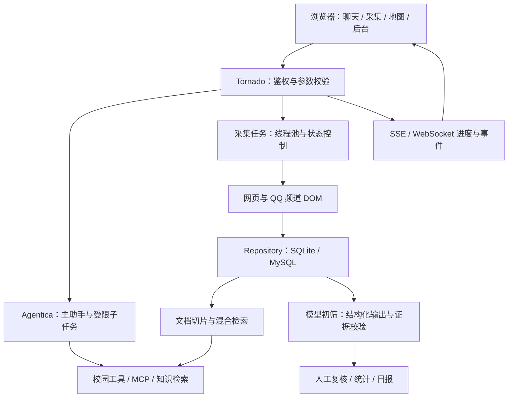

# CampusAgentOS · 智慧校园 AI 应用平台

面向西华师范大学校园场景的 Python 全栈项目，将 **AI 对话、多智能体协作、知识检索、网页与 QQ 频道采集、舆情初筛、三维校园地图和后台管理**整合为一套可运行的应用。

技术重点是把模型调用接入完整业务：数据从哪里来、如何检索和引用、长任务如何反馈进度、失败如何恢复，以及账号权限与人工复核如何落地。适合展示 **Python 后端、AI 应用开发和全栈工程**能力。

**技术栈：** Python · Tornado · Agentica · OpenAI 兼容接口 · SQLite / MySQL · Playwright · BeautifulSoup · Crawl4AI · Three.js · ECharts · Layui。

[功能与技术](#功能与对应技术) · [快速运行](#快速运行) · [验证记录](docs/validation-2026-11-24.md)

## 功能与对应技术

| 功能 | 用户能做什么 | 实现技术与工程要点 |
| --- | --- | --- |
| AI 对话与数字员工 | 多轮问答、切换不同职责的助手、临时对话、查看来源、导出 PDF | Tornado 异步处理、SSE 流式输出、Agentica 工具调用、按用户组织会话、ReportLab |
| 多智能体协作 | 将多个研究方向交给子任务并汇总，查看子任务状态与返回内容 | Agentica 子智能体、只读工具白名单、ContextVar 查询预算、超时与结构化事件；隔离子任务上下文，限制递归派发 |
| 知识仓库与 RAG | 上传 TXT / Markdown / Word，将资料绑定到数字员工，检索后引用来源 | 标题/段落切片、中文词元 BM25、向量相似度混合排序；无嵌入模型时使用本地词项向量；文档每页 15 条 |
| 网页采集与数据仓库 | 维护 URL、请求头和参数模板，批量采集并深采正文 | Requests、BeautifulSoup、Crawl4AI / Playwright、HTML→Markdown、后台执行、Repository 持久化 |
| QQ 频道检索 | 后台维护多个频道，选择频道、关键词和日期检索，查看历史并停止任务 | Playwright 操作实际频道内搜索、DOM 解析、范围校验、帖子 ID 去重、任务状态机、分页；搜索阶段只读取摘要 |
| 帖子图片与评论 | 打开选中帖子后读取全文、图片地址、评论及嵌套回复，集中审核整帖 | 图片 URL 提取与去重、排除头像/表情、原图链接与失败提示；按 parent_id 组织回复、按需展开、旧记录补采图片 |
| 舆情初筛与热门日报 | 筛选待核实线索、查看原文依据，生成热门话题摘要和通知 | 结构化模型输出、连续原文片段校验、人工审核独立保存、APScheduler、SMTP；失败保留为待重试 |
| 三维校园地图 | 行署/华凤校区切换、搜索楼宇、平移缩放、俯视、导览与测距 | Three.js、GLB、射线拾取、标注避让、相机控制、局部坐标与水平距离；名称校正随模型重建保留 |
| 数智大屏与智能问数 | 查看统计、趋势、地理分布和线索明细，用自然语言查询业务快照 | ECharts、Three.js、SSE / WebSocket、统计查询、结构化报告、可滚动明细与下钻 |
| 3D 数字人和语音 | 与“华小竹”数字辅导员交互，使用语音输入、朗读和动作 | Three.js 程序化模型 / VRM、Web Speech API、口型与动作状态、触屏交互 |
| 身份与后台权限 | 管理账号、角色、菜单、登录设备，录入和启停人脸登录 | PBKDF2、数据库 Token 会话、XSRF、菜单权限、登录审计；ONNX 人脸模型与特征加密 |

**代码入口：** [智能体编排](app/services/agent_service.py) · [SSE 对话](app/controllers/chat.py) · [混合检索与证据校验](app/services/intelligence_service.py) · [QQ 采集](app/services/qq_channel_service.py) · [频道存储](app/models/qq_channel.py) · [热门日报](app/services/qq_daily_service.py) · [信源管理](app/models/source.py) · [地图交互](app/static/js/campus-map.js) · [双数据库访问层](app/models/db.py) · [统一鉴权](app/controllers/base.py)

## 架构与数据流



`controllers` 处理 HTTP、鉴权和响应；`services` 执行采集、模型编排和检索；`models` 用 Repository 管理持久化。耗时采集在后台执行，前端通过状态查询或事件流获取进展。

采集链路为 **信源配置 → 搜索/抓取 → 去重与存储 → 按需读取全文、图片和评论 → 初筛 → 人工核实**。摘要、正文和评论保留各自来源范围，避免把摘要当作已核实全文。

## 工程设计

1. **长任务可观察：** 对话工具调用和子任务通过事件反馈；采集具有等待、运行、停止、失败和重启中断等状态。
2. **受限智能体执行：** 子任务只用允许的查询工具，共享查询预算并设置超时，不继承完整主会话上下文，也不继续派发子任务。
3. **检索与初筛可追溯：** BM25 结合向量匹配；非普通风险结果须提供原文中的连续证据片段，未通过校验则待重试。
4. **按需采集：** 先读搜索摘要，进入选中帖子后才读取全文、图片地址与评论，减少不必要的页面访问。
5. **外部依赖有边界：** 对模型、登录、数据源和人脸引擎故障给出错误或降级行为；地图保留名称来源及待核验信息。
6. **持久层可替换：** SQLite / MySQL 访问层统一占位符、行结构与异常，上层业务复用 Repository 查询。


## 快速运行

建议使用 Python 3.11，版本以 [requirements.txt](requirements.txt) 为准。Windows PowerShell 示例：

```powershell
python -m venv venv
.\venv\Scripts\python.exe -m pip install -r requirements.txt
.\venv\Scripts\python.exe -m playwright install chromium
Copy-Item .env.example .env
python -c "import secrets; print(secrets.token_urlsafe(48))"
# 将生成值填入 .env 的 COOKIE_SECRET，再配置模型地址等参数。
.\venv\Scripts\python.exe tools\seed_employees.py
.\venv\Scripts\python.exe app.py
```

默认访问 `http://127.0.0.1:10086`。首次启动会建表；在 `/auth/register` 注册账号后，由本地数据库管理员授予 `admin` 角色。参阅 [.env.example](.env.example) 和 [部署文档](docs/deploy.md)。

**配置 QQ 频道：** 信源管理 → 新增 QQ 频道 → 填写名称和频道号并启用 → 在采集管理的 QQ 频道页选择。首次连接由本机管理员在腾讯窗口自行登录，并确保拥有频道访问权限。业务数据库和浏览器登录资料不随代码上传，新环境需重新配置频道。

| 入口 | 用途 |
| --- | --- |
| `/`、`/avatar`、`/qa` | 对话、数字人、智能问数 |
| `/campus-map` | 行署与华凤校区三维地图 |
| `/admin/sources`、`/collect`、`/collect/qq` | 信源维护、网页采集、QQ 频道检索 |
| `/admin/warehouse`、`/admin/knowledge` | 数据仓库、知识文档入库 |
| `/admin/sentiment`、`/admin/dashboard` | 舆情初筛、统计大屏 |
| `/admin/employees`、`/admin/tools`、`/admin/models` | 数字员工、工具和模型配置 |
| `/admin/users`、`/admin/roles`、`/admin/tasks` | 账号权限、定时任务 |

## 验证与能力边界

项目包含 pytest 接口/服务测试、Node DOM 回归和 Playwright 桌面/移动端检查。本批修改的实际验证范围见 [验证记录](docs/validation-2026-11-24.md)。

```powershell
.\venv\Scripts\python.exe -m pip install -r requirements-test.txt
.\venv\Scripts\python.exe -m pytest tests/pytest/test_qq_sources.py tests/pytest/test_qq_channel.py tests/pytest/test_campus_map.py tests/pytest/test_chat_collaboration.py -q
node tests/test_qq_channel_ui.cjs
node tests/test_campus_map_labels.cjs
.\venv\Scripts\python.exe tests/test_chat_collaboration_ui.py
```

- **模型：** 接入可配置的大模型与嵌入模型，没有自行训练基础模型。真实回答质量和延迟受模型影响，模拟接口测试不代表线上效果。
- **采集：** 受权限、搜索返回和翻页/数量上限影响，不保证全历史覆盖。图片保存 URL 并展示原图链接，未实现 OCR、音视频转写或图片永久归档。
- **初筛：** 高风险和关注均为待人工核实线索，不代表事实或违规认定；规则仍可能漏判或误判。
- **地图：** 白模用于校园展示，名称校正含用户截图依据；分栋区域、楼高和校门点位非实测导航数据。
- **规模：** 默认单进程，频道任务使用进程内互斥；多实例部署需外置队列、共享锁和会话/存储方案，暂无生产并发压测结论。
- **身份与语音：** 人脸登录需要可用 ONNX 模型，实机效果受设备和环境影响；语音功能取决于浏览器支持。

## 文档与资源来源

[项目讲解](docs/project-showcase.md) · [架构](docs/architecture.md) · [API](docs/api.md) · [部署](docs/deploy.md) · [QQ 频道实现](docs/qq-channel-implementation.md) · [校园地图](docs/campus-map/README.md) · [数字员工](docs/cwnu-employees.md) · [校园信源](docs/cwnu-sources.md)
